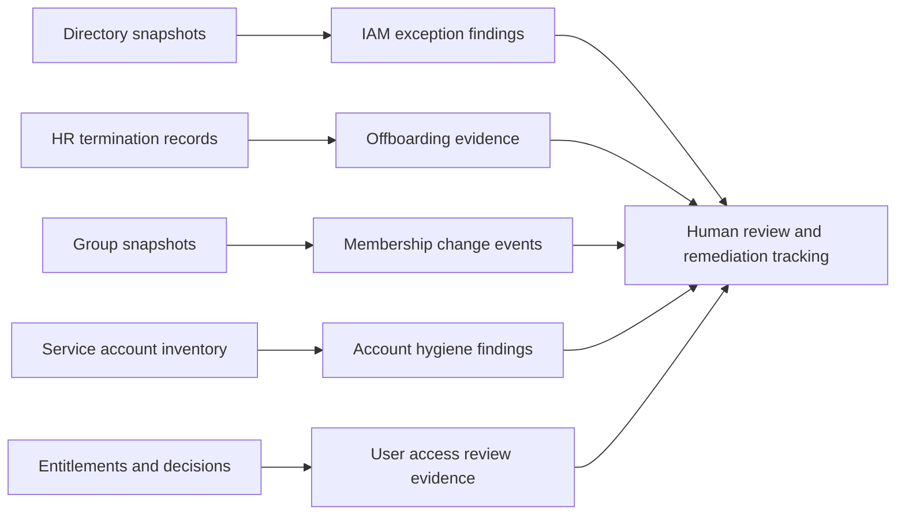

# IAM Automation Portfolio
**Five read-only PowerShell projects for identity operations, access governance, risk detection, and audit evidence.**

A practical portfolio showing the engineering behind common identity and access management controls: normalizing evidence, comparing authorization state, surfacing exceptions, and producing reports that operators can actually review.

**[Browse the projects](#the-five-projects) · [Run a synthetic demo](#try-a-demo) · [Engineering standards](#engineering-standards) · [Deployment boundaries](#deployment-boundaries)**

> **Evaluation software, not an attestation or compliance certification.** The demos use entirely synthetic identities, groups, and entitlements. Outputs are findings for human review. No tool grants, changes, disables, approves, or revokes access.

## The five projects

| Project | What it demonstrates | GitHub Actions |
| --- | --- | --- |
| **[01 — AD/LDAP Exception & Risk Analyzer](https://github.com/norones-rgb/ad-ldap-exception-risk-analyzer)** | Nested privileged group analysis, stale accounts, authentication configuration, directory exception prioritization | [](https://github.com/norones-rgb/ad-ldap-exception-risk-analyzer/actions/workflows/ci.yml) |
| **[02 — Employee Offboarding Verification](https://github.com/norones-rgb/employee-offboarding-verification-tool)** | HR-to-AD-to-application reconciliation, residual entitlements, missing evidence | [](https://github.com/norones-rgb/employee-offboarding-verification-tool/actions/workflows/ci.yml) |
| **[03 — AD Group Membership Change Tracker](https://github.com/norones-rgb/ad-group-membership-change-tracker)** | Baseline vs. current group snapshots, privileged membership change detection, collection completeness | [](https://github.com/norones-rgb/ad-group-membership-change-tracker/actions/workflows/ci.yml) |
| **[04 — Service Account Hygiene Auditor](https://github.com/norones-rgb/service-account-hygiene-auditor)** | Traditional service account and gMSA/sMSA checks, delegation exposure, identity ownership | [](https://github.com/norones-rgb/service-account-hygiene-auditor/actions/workflows/ci.yml) |
| **[05 — User Access Review Evidence Generator](https://github.com/norones-rgb/user-access-review-evidence-generator)** | Review campaign evidence, entitlement-to-decision reconciliation, baseline differences, source provenance | [](https://github.com/norones-rgb/user-access-review-evidence-generator/actions/workflows/ci.yml) |

## Try a demo

**Requirements:** PowerShell 7.2 or later. Clone an individual repository and run its synthetic demo from the repository root; no production directory, credentials, API token, or application connection required.

```powershell
# Project 01 (AD/LDAP analyzer)
./Invoke-AdExceptionAnalyzer.ps1 -Mode Csv -AsOfUtc '2026-11-05T12:00:00Z'

# Project 02 (Offboarding verification)
./Invoke-OffboardingVerification.ps1 -Mode Csv -AsOfUtc '2026-11-05T12:00:00Z'

# Project 03 (Group membership change tracker)
./Invoke-GroupMembershipTracker.ps1 -Action Demo

# Project 04 (Service account auditor)
./Invoke-ServiceAccountHygieneAudit.ps1 -Mode Demo -AsOfUtc '2026-11-05T19:00:00Z'

# Project 05 (User Access Review)
./Invoke-UserAccessReview.ps1 -Mode Demo
```

Each repository includes a **[demo guide](#demo-guides)**, an offline HTML preview, synthetic fixtures, and test instructions. Run one project's command **inside that project's own folder**.

### Demo guides

- [01 — AD exceptions](https://github.com/norones-rgb/ad-ldap-exception-risk-analyzer/blob/main/DEMO.md)
- [02 — Offboarding](https://github.com/norones-rgb/employee-offboarding-verification-tool/blob/main/DEMO.md)
- [03 — Group changes](https://github.com/norones-rgb/ad-group-membership-change-tracker/blob/main/DEMO.md)
- [04 — Service accounts](https://github.com/norones-rgb/service-account-hygiene-auditor/blob/main/DEMO.md)
- [05 — Access reviews](https://github.com/norones-rgb/user-access-review-evidence-generator/blob/main/DEMO.md)

## Engineering standards

1. **Read-only by design.** No mutation of identities, group membership, entitlements, or review decisions.
2. **Fail closed on ambiguous evidence.** Incomplete group queries, missing exports, unknown identities, and unresolved memberships become explicit findings or validation errors—not invented clean results.
3. **Reproducible synthetic examples.** Pinned dates and known fixture expectations make demos reviewable by hiring teams and pilot sponsors.
4. **Multiple evidence formats.** CSV for filtering, JSON for integration, and standalone HTML for human review. Reports neutralize HTML injection and spreadsheet formula payloads where relevant.
5. **Automated regression checks.** Pester suites execute in GitHub Actions on Windows and Linux. Workflow success demonstrates test execution, not approval to use against production systems.
6. **Scoped live collectors where available.** AD modes require appropriate RSAT modules, deliberate scope selection, authorized read-only permissions, and validation against local security policies.

### How the projects fit together



These are **five separate evaluators**, not a unified SaaS platform. Their findings may eventually feed a shared governance workflow after schemas and control boundaries are deliberately harmonized.

## Deployment boundaries

- Synthetic data is safe for public demonstration; real account details and audit exports are sensitive.
- Run against only directories and applications you are authorized to inspect. Start with a test or scoped pilot.
- Always verify findings with source owners, ticket evidence, and organization-approved controls before acting.
- Account inactivity indicators can be approximate, privileged access may be inherited through nested memberships, and an absence from a partial export **does not** prove removal of access.
- A successful test matrix cannot establish full production security, correctness under every directory topology, or regulatory compliance.
- No open-source license is granted unless one is explicitly added to a repository; review the `NOTICE` and `SECURITY.md` files before reuse.

## Roadmap

- [x] Five GitHub repositories and synthetic examples
- [x] Read-only analysis engines with HTML / CSV / JSON reporting
- [x] Pester + GitHub Actions cross-platform test workflows
- [x] Common portfolio navigation and demo documentation
- [ ] Authorized live-data pilots with explicit data-handling controls
- [ ] Operator-reviewed exception disposition workflow
- [ ] Shared evidence schema and consolidated dashboard
- [ ] Separate licensing and support model for commercial ISGIN services

---

**Portfolio context:** These projects demonstrate practical IAM automation design. They are independently built examples and are not representations of any employer's systems, exports, or internal controls.
